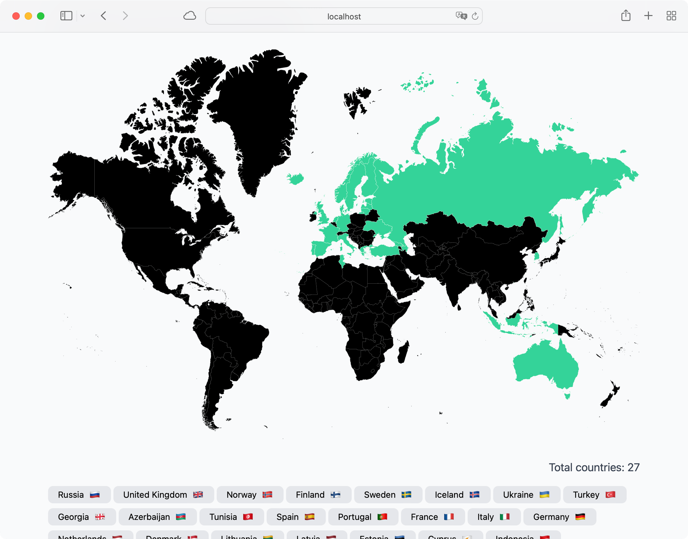

# Travel Map

Travel Map lets you mark countries you’ve visited on a world map and share the link with friends.



## Project setup
```sh
$ npm install
```

### Compiles and hot-reloads for development

```sh
$ npm run dev
```

### Compiles and minifies for production

```sh
$ npm run build
```

### Preview production build

```sh
$ npm run preview
```

## Hosting

Cloudflare Pages builds `main` with `npm run build`, output directory `dist`, and Node.js 26.

Domain: travelmap.dan.kim.
